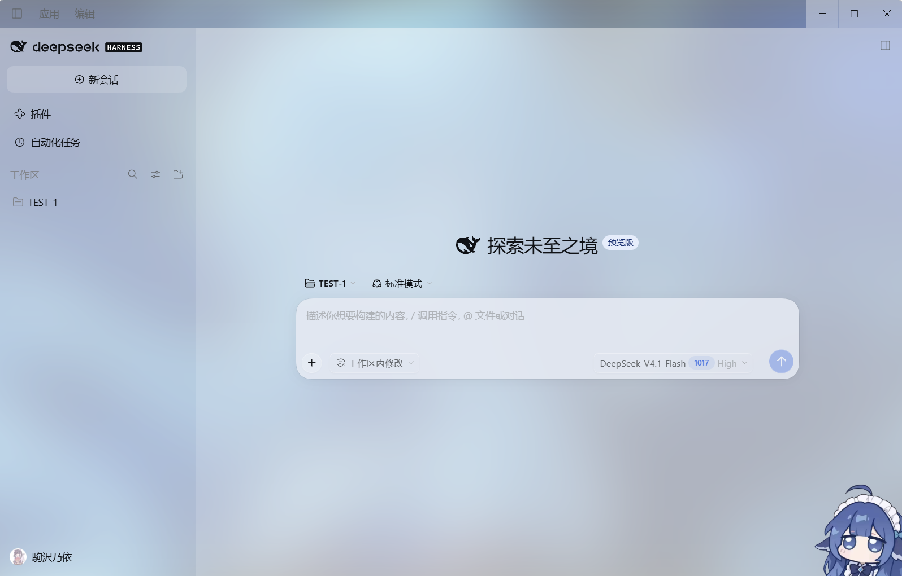

# 大肥鱼窗口模糊插件

> Big Fish Window Blur — DeepSeek Harness 的液态玻璃外观。
>
> 整个 Harness 窗口变成一张磨砂玻璃：透出你桌面壁纸的颜色，面板半透明，控件是 Apple 液态玻璃质感；同时保证正文、代码、菜单都读得清。



## 它做了什么

| 部位 | 效果 |
| --- | --- |
| 窗口底 | 读取当前桌面壁纸，模糊 46px + 一层白纱，作为整页画布 |
| 侧栏 / 聊天面板 | 20% / 26% 白的玻璃，能透出壁纸 |
| 卡片 / 气泡 / 文件卡 | 40–68% 白，卡片重量但不发白 |
| 输入框卡片 | 88% 冷灰蓝，玻璃但不透字 |
| 代码块 / diff | 20% 冷白 + `backdrop-filter: blur(34px)` |
| 文档预览 / 右栏 | 94% 冷灰蓝 + `blur(44px)` |
| 菜单 / 弹层 | 92–97%，模糊 48px |
| 设置对话框 | 97%，整页文字必须能读 |
| 插件市场等第三方页面 | 该子树内层 token 提到 55/72/86% + `blur(44px)` |
| 搜索框 | 55% 底 + `blur(28px)`，placeholder 清楚 |
| 按钮 | 输入区按钮带一圈高光 + 轻微浮起 + 按下回弹 |

一句话原则：**容器透、内容实**。玻璃给界面，可读性给文字。

## 安装

### 方式一：命令行（推荐）

```bash
# 桌面版（desktop profile）
dsh plugin --profile desktop add github:HoloEN-Gwargura/dsh-bigfish-blur

# Web 版
dsh plugin --profile web add github:HoloEN-Gwargura/dsh-bigfish-blur
```

Windows 桌面版的 CLI 在 `E:\Program Files\Deepseek\resources\runtime\cli\bin\dsh.cmd`（按你的安装路径来）。

### 方式二：插件页安装

Harness 里打开「插件」页 → 搜索 `dsh-bigfish-blur`，或在「安装」里填：

```
github:HoloEN-Gwargura/dsh-bigfish-blur
```

### 方式三：下载 zip 手动装

1. 在仓库页点 `Code → Download ZIP`，解压到任意目录（例如 `D:\plugins\dsh-bigfish-blur`）；
2. 插件页 → 安装本地插件 → 选这个目录。

### 装完必须重启

窗口材质和客户端样式在**启动时**加载，装完请完全退出 Harness 再打开（不是刷新页面）。

## 兼容性

- Windows 10/11、macOS、Linux 都能用（外观由插件绘制，不依赖系统材质）。
- Windows 上读取壁纸需要能访问 `%APPDATA%\Microsoft\Windows\Themes\TranscodedWallpaper`；读不到时自动退回自带的渐变画布。
- 深色主题有独立的暗色磨砂配方。
- 系统开启「减少透明」时，画布会自动退回纯色，不再模糊。

## 想自己调

所有材质都是 CSS 变量，在 `client.js` 的 `GLASS_TOKENS` 里：

```js
'--dsw-specific-sidebar-fill': { light: 'rgba(255, 255, 255, 0.20)', dark: ... },  // 侧栏通透度
'--dsw-alias-bg-base':        { light: 'rgba(255, 255, 255, 0.26)', dark: ... },  // 聊天面板
'--dsw-specific-input-major': { light: 'rgba(228, 234, 243, 0.88)', dark: ... },  // 输入卡
```

调通透度的经验：**想要"更不透明"就加模糊或加深色相，不要加白**（加白会变成纸）；**想要"更透"别只降 alpha**（会透出文字）。

改完同样需要重启 Harness。

## 卸载 / 回滚

插件页里禁用或移除 `dsh-liquid-glass` 即可，不写入任何系统文件。

（可选的进阶项：若你希望窗口真的透出后面的其他窗口，而不是只透壁纸，需要给 `app.asar` 打窗口材质补丁 —— 这属于 Harness 本体改动，本插件不包含；补丁会在每次 Harness 更新后丢失。）

## 原理

- **Host 半层**：读 `TranscodedWallpaper`，通过 `webserver/index-inject` 把壁纸作为 `--lg-wallpaper` 注入页面。
- **Client 半层**：用 `ctx.theme.overrideTokens` 把产品的不透明材质换成半透明玻璃，再挂一张自有样式表，负责画布、控制件质感、以及"清杂线"（标题条、输入区、侧栏渐隐遮罩、卡片描边）。

为什么不直接用 Windows 的亚克力：在这台机器上它会输出一层与后方内容无关的奶黄色，无法控制。插件自己画磨砂底，颜色可控且跨平台一致。

## 许可

MIT
